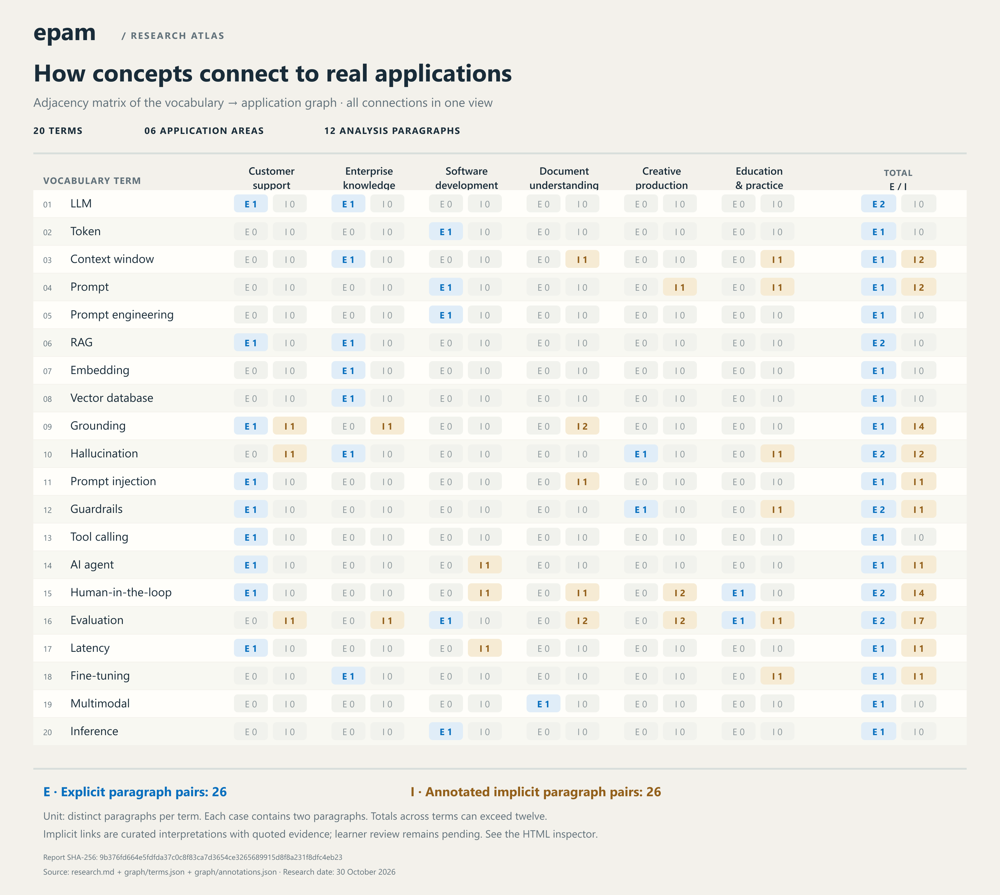

# epam

EPAM training assignment: practical generative AI applications, a vocabulary, and a reproducible relationship graph.

- [Research report](research.md): six application areas, two analysis paragraphs per case, twelve implementation examples, and fourteen primary sources.
- [Vocabulary](vocabulary.md): twenty technical terms with plain-language definitions and report examples; personal review has started with five terms.
- [Relationship graph](graph/index.html): an interactive, offline map with separate explicit and implicit frequencies and inspectable evidence.
- [Static graph image](graph/relationships.png): a readable PNG overview of every term-to-application relationship, with an [SVG version](graph/relationships.svg) and recorded export provenance.
- [Counting methodology](graph/README.md): corpus boundaries, aliases, annotation rules, and limitations.
- [Resource access checks](access-checks.md): the supplied course resources, observed sign-in pages, and outstanding access issues.



## View and reproduce

Download or clone the repository, then open `graph/index.html` in a browser. GitHub's file view displays the HTML source rather than running it. The generated page is self-contained and needs no server, API key, external library, or network connection.

To rebuild, use Node.js 20 or newer. There are no package dependencies and no installation step.

```sh
git clone https://github.com/Kzen07/epam.git
cd epam
npm run build
npm test
npm run check
npm run check:export
npm run validate
```

`validate` checks report structure, source links, vocabulary anchors, graph integrity, and access metadata; the [acceptance review](acceptance-review.md) lists what it covers and what still needs a human. `build` produces `graph/usage-data.json` and `graph/index.html`. `check` fails if those files no longer match their source inputs. `check:export` verifies the static SVG and the PNG provenance hashes without loading an image-rendering package. GitHub Actions runs the checks on pushes and pull requests.

### Static exports

`npm run export` regenerates the SVG with Node.js built-ins. The committed PNG can be viewed directly on GitHub. Regenerating the PNG requires the optional `sharp` renderer:

```sh
npm install --no-save --package-lock=false sharp
npm run export:png
npm run check:export
```

The normal build, tests, and validation still need no dependency installation. PNG regeneration records the source data hash, SVG hash, image hash, renderer version, and pixel dimensions in `graph/png-export.json`. Different font environments can change pixels; the generated SVG and recorded counts remain inspectable.

## Project structure

```text
research.md                 Application report and sources
vocabulary.md               Definitions and examples
access-checks.md            Course resources and access-check results
acceptance-review.md        Structural acceptance matrix and its limits
graph/
  README.md                 Counting and interpretation rules
  terms.json                Term IDs and explicit aliases
  annotations.json          Implicit evidence and reasons
  template.html             Viewer page structure
  style.css                 Viewer styles
  viewer.js                 Filters, graph, and evidence inspector
  usage-data.json            Generated counts and evidence
  index.html                Generated standalone viewer
  relationships.svg         Generated static adjacency matrix
  relationships.png         PNG export at 3240 by 2900 pixels
  png-export.json           Input and output hashes for the PNG
scripts/
  analysis.mjs              Corpus extraction and counting
  build-graph.mjs            Reproducible artifact generation
  export-graph.mjs           Static SVG and optional PNG export
  validate-assignment.mjs    Structural acceptance checks (npm run validate)
tests/
  analysis.test.mjs          Counting and annotation checks
.github/workflows/
  validate.yml              Automated validation
```

## Assignment readiness

| Requirement | Current state |
| --- | --- |
| Dedicated shareable repository | Public repository: [Kzen07/epam](https://github.com/Kzen07/epam) |
| Research Markdown file | Prepared with six cases and linked implementations |
| Vocabulary Markdown file | Prepared; personal learning notes added for five terms, further review pending |
| Optional relationship graph | Interactive HTML plus SVG and PNG overview; separate paragraph frequencies and quoted evidence |
| Reproducibility | Build, freshness validation, and automated counting tests included |
| Required course-resource access | Check documented: learner reports that only AIST and EliteA do not open; direct observations and the separate Copilot Free / educational-license uncertainty are recorded in [access checks](access-checks.md) |
| Submission text file | Prepared separately as `Intro_Aldiyar_Amantay.txt` with the learner-supplied EPAM email and the verified repository URL |
| Upload and final submission | Pending; requires the learner's explicit confirmation |

The learner has contributed initial explanations for RAG, hallucination, tool calling, and human-in-the-loop, and identified fine-tuning as an unfamiliar concept. The vocabulary records those starting points and clarified distinctions. Further review of the definitions and implicit annotations remains pending; a full independent review is not claimed.

## Access checks

Checked on 30 October 2026: the repository is public, Git clone and push succeeded, the remote commit matched the local commit, and GitHub associated the author and committer with `Kzen07`. The initial GitHub Actions validation completed successfully. A connected GitHub integration returned `Unknown tool`, so this project uses the local Git client.

The learner subsequently supplied the course resource list and confirmed that only AIST and EliteA do not open; the remaining listed resources open in the learner's session. Direct checks observed a DNS failure for the supplied EliteA hostname and a browser navigation timeout for AIST. The authenticated GitHub settings page displayed Copilot Free; the course-provided educational license remains unconfirmed. See [access-checks.md](access-checks.md) for the distinction between direct observations and learner-reported access. Course enrollment and upload controls have not been independently inspected, and no platform submission has been performed.

## Submission procedure

`Intro_Aldiyar_Amantay.txt` has been prepared outside this public repository using the learner-supplied EPAM email and the verified repository URL. It contains exactly those two lines, without labels or extra comments. The Git commit email is not used in place of the EPAM email.

The original instructions allow only one upload attempt. The learner must explicitly confirm uploading the prepared file and submitting it on the training platform. No upload has been performed. Optional work and automation provide evidence of initiative, but the mentor determines the final score.
