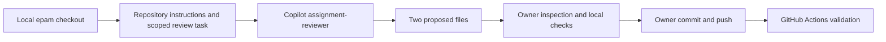

# Repository review workflow

This repository includes a scoped Copilot custom-agent profile and a concrete assignment-review task. The task is tied to files in this Git repository, rather than being a generic chat exercise.

## Configuration

- [Repository instructions](../.github/copilot-instructions.md) preserve the assignment scope, English deliverables, evidence limits, and publication rules.
- [Assignment reviewer](../.github/agents/assignment-reviewer.agent.md) enables file reading, searching, and editing. It has no execution, web, or agent-delegation tools.
- [Review task](review-task.md) asks for a structural acceptance validator and a concise evidence matrix, while preserving the report, definitions, graph data, existing tests, and owner-controlled Git publication.



## Repeat the task

Install the official [GitHub Copilot CLI](https://docs.github.com/en/copilot/how-tos/copilot-cli/set-up-copilot-cli/install-copilot-cli) if needed, sign in through the normal GitHub authorization flow, and run the task from the repository root. The following PowerShell invocation uses the existing account's plan and explicitly scopes file-write approvals:

```powershell
copilot login
$reviewPrompt = Get-Content -LiteralPath automation/review-task.md -Raw
copilot --trust-folder --agent assignment-reviewer `
  --disable-builtin-mcps `
  --allow-tool read `
  --allow-tool 'write(scripts/validate-assignment.mjs)' `
  --allow-tool 'write(automation/acceptance-review.md)' `
  --deny-tool shell `
  --no-ask-user --no-auto-update --sync-session=off `
  --max-ai-credits 30 -p $reviewPrompt
```

`--trust-folder` trusts this checkout's configuration for the run; it does not grant blanket command execution or publication permission. The profile excludes execution tools, and the invocation allows writes to just the two task outputs. Copilot's OAuth account permissions are broader than the file-task approvals; authentication is a separate, explicitly approved setup step. Tokens and raw local session logs belong outside the public repository.

The generated validator can inspect structural requirements, but it cannot award a grade or prove learner understanding, source accuracy, authenticated EPAM access, or final platform submission. The owner must inspect both proposed files and run the checks. A successful run must be evidenced separately; configuration files alone do not establish that the agent executed.

## References

- [GitHub: Invoking custom agents](https://docs.github.com/en/copilot/how-tos/copilot-cli/use-copilot-cli/invoke-custom-agents)
- [GitHub: Custom agent configuration](https://docs.github.com/en/copilot/reference/custom-agents-configuration)
- [GitHub: Copilot CLI programmatic reference](https://docs.github.com/en/copilot/reference/copilot-cli-reference/cli-programmatic-reference)
